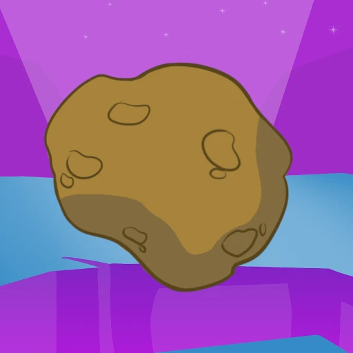
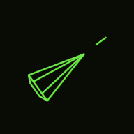
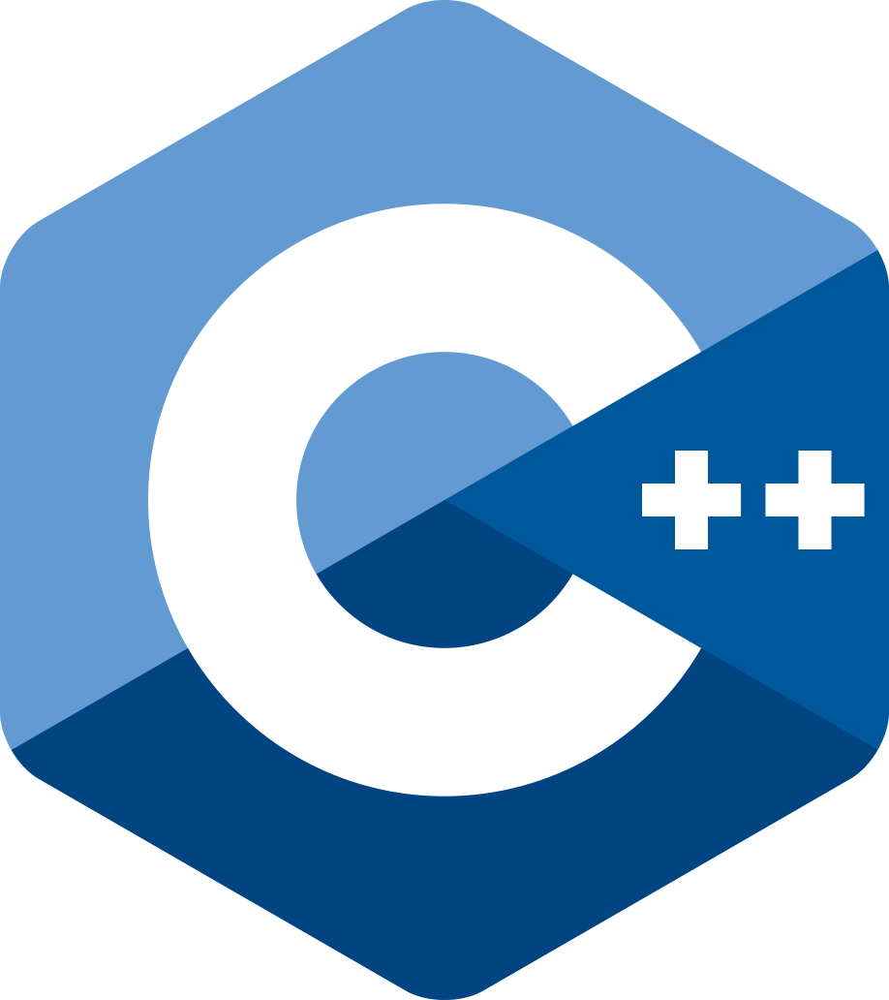
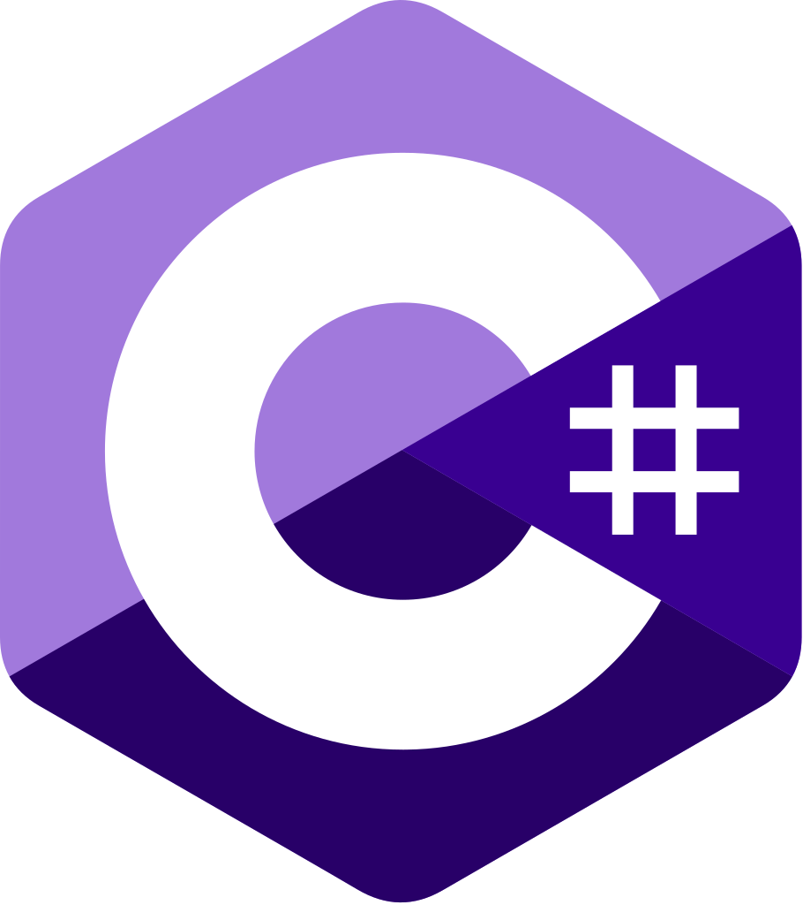
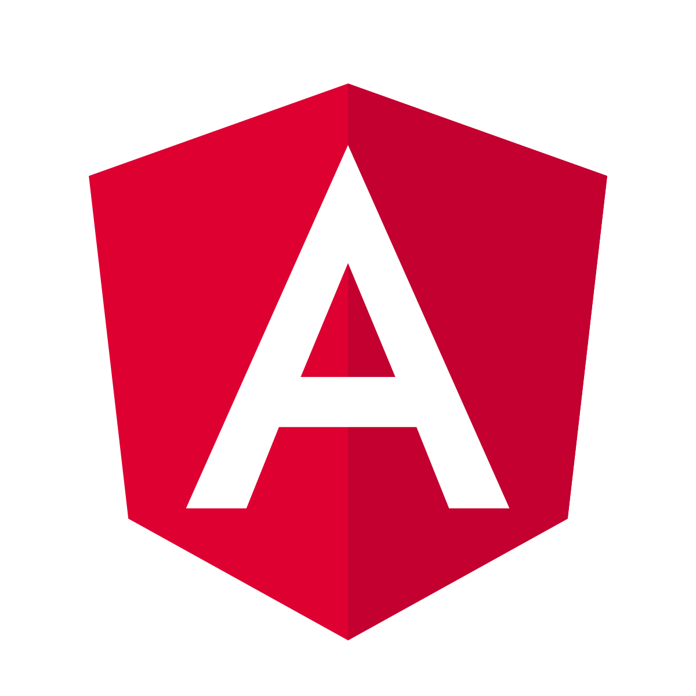
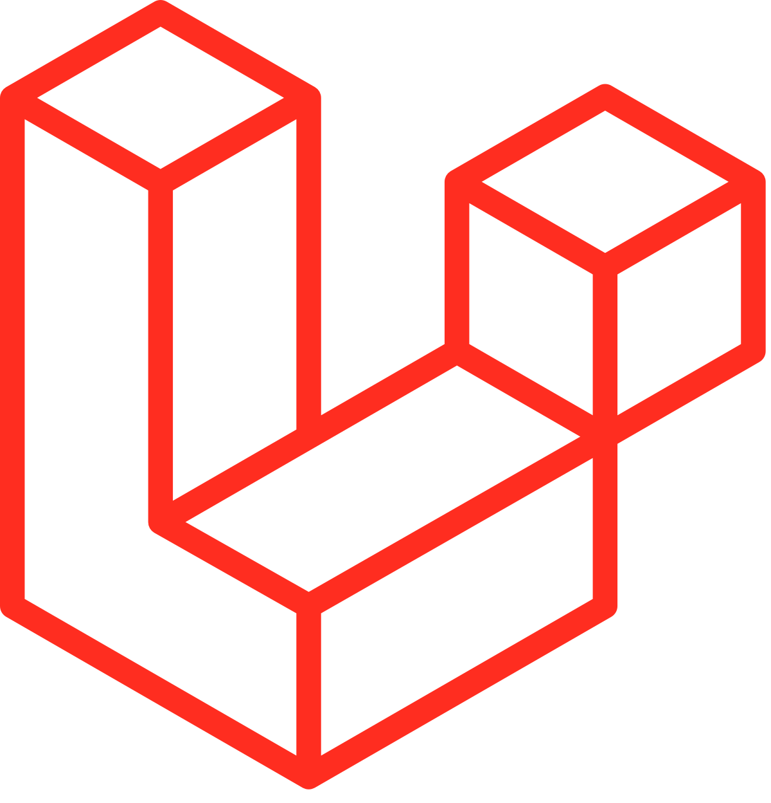

I am an independent software and mobile game developer.

## Portfolio

<table id="portfolioTable" style="width: 100%">
  <thead>
    <tr>
      <th>Title</th>
      <th>Description</th>
      <th>Tech</th>
      <th>Platform</th>
      <th>Year</th>
    </tr>
  </thead>
  <tbody>
    <tr>
      <td>
        
Space Typer

        
      </td>
      <td>Singleplayer and multiplayer typing speed game.</td>
      <td>
        
      </td>
      <td>
        
      </td>
      <td>2025</td>
    </tr>
    <tr>
      <td>
        
Vortex

        
      </td>
      <td>Hypercasual endless mobile dodging game.</td>
      <td>
        <a target="_blank" href="https://raylib.com"
          ></a
        >
      </td>
      <td>
        
      </td>
      <td>2024</td>
    </tr>
    <tr>
      <td>
        
Blasteroids!

        
      </td>
      <td>Mobile 'Asteroids' inspired arcade game.</td>
      <td>
        
      </td>
      <td>
        <a
          target="_blank"
          href="https://play.google.com/store/apps/details?id=com.doomhowl.blasteroids"
          title="Google Play"
          ></a
        ><a
          target="_blank"
          href="https://chromewebstore.google.com/detail/ibmhkhgiibicgnagnhdcockipmalmhki?utm_source=item-share-cb"
          title="Chrome Web Store"
          ></a
        >
      </td>
      <td>2023</td>
    </tr>
  </tbody>
</table>

## Toolbox

<table>
  <tr>
    <th>Languages</th>
    <td style="vertical-align: bottom">
      
      
      
    </td>
    <td style="vertical-align: bottom">
      
      
      
      
    </td>
  </tr>
  <tr>
    <th>Frameworks</th>
    <td style="vertical-align: bottom">
      
      
    </td>
    <td style="vertical-align: bottom">
      
      
      
    </td>
  </tr>
</table>

<!--
<picture>
  <source srcset="https://git.doomhowl-interactive.com/commitchart/2025.png?darkMode=true" media="(prefers-color-scheme: dark)">
  
</picture>

  
2024

  <picture>
    <source srcset="https://git.doomhowl-interactive.com/commitchart/2024.png?darkMode=true" media="(prefers-color-scheme: dark)">
    
  </picture>

-->

## Links

 [Youtube](https://www.youtube.com/@brambasiel) 
 [Twitch](https://www.twitch.tv/brambasiel)
